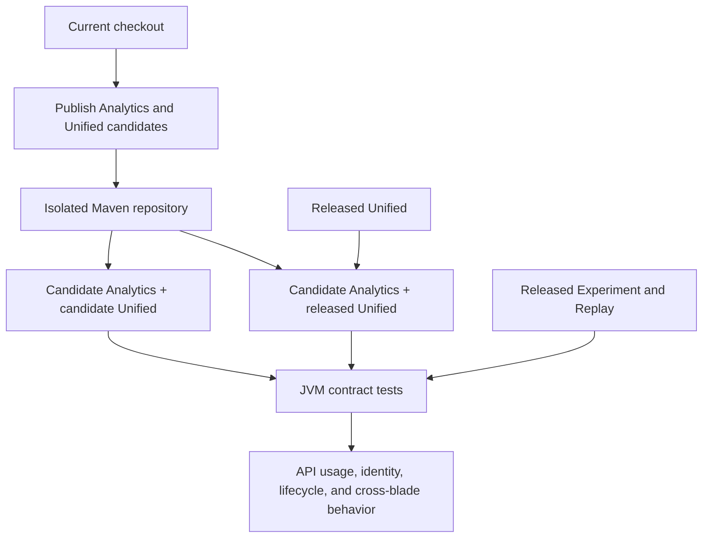

# SDK verification

Customer-style tests consume published Analytics and Unified artifacts with released Experiment and Session Replay plugins. Engagement is outside this suite.

Every PR runs two JVM combinations: candidate Analytics with candidate Unified, and candidate Analytics with released Unified. The latter executes existing Unified bytecode against Analytics changes.

| Gate | Regressions it catches |
|---|---|
| Artifact resolution | Missing Unified dependencies, unexpected versions, project substitution |
| Kotlin and Java consumers | Constructors, builders, plugin interfaces, accessors, inherited Analytics calls |
| Published blades | Registration timing, identity/properties/session, reset, opt-out, exposure, ownership, replacement |
| Third-party host | `AnalyticsClient`, `PluginHost`, and `UniversalPlugin` contracts without an Amplitude host |
| Unified wrapper | Enablement combinations, instance isolation, removal, setup failure, identity-then-track ordering |

The third-party host is a test fixture. Product behavior runs through published SDK implementations. MockWebServer supplies local responses; the setup-failure test mocks only the failing Replay setup boundary.

## How it works



Tests resolve Maven artifacts rather than project dependencies. Running released Unified against candidate Analytics checks compatibility with already-compiled consumer code.

## Run the artifact matrix

Use JDK 21. Keep the candidate repository isolated from other local publications:

```bash
verification_repo="$PWD/build/verification-maven"
candidate="$(sed -n 's/^VERSION_NAME=//p' gradle.properties)-verification-$(git rev-parse --short HEAD)-SNAPSHOT"
released_unified=$(sed -n 's/^VERSION_NAME=//p' unified/gradle.properties)
./gradlew :analytics-core:publishToMavenLocal :android:publishToMavenLocal :unified:publishToMavenLocal \
  -PVERSION_NAME="$candidate" -Dmaven.repo.local="$verification_repo"
./gradlew sdkVerificationTest -PsdkVerificationKotlinVersion="$candidate" \
  -PsdkVerificationUnifiedVersion="$candidate" -Dmaven.repo.local="$verification_repo"
./gradlew sdkVerificationTest -PsdkVerificationKotlinVersion="$candidate" \
  -PsdkVerificationUnifiedVersion="$released_unified" -Dmaven.repo.local="$verification_repo"
```

Blade versions default to Unified's version catalog. Override them with `sdkVerificationExperimentVersion` and `sdkVerificationSessionReplayVersion` when investigating compatibility. Version constraints select the candidate Analytics artifacts without supplying dependencies missing from Unified metadata.


## Known upstream limitation

Published Replay 0.31.0 enriches `BaseEvent` through its legacy `EventPlugin` adapter. A host supplying another `AnalyticsEvent` implementation receives no Replay ID. The custom-event regression retains the expected assertion but is skipped in the required gate until Replay supports it. Reproduce with `-PsdkVerificationCustomEvents=true` added to the verification command. The existing third-party-host gate uses the supported `BaseEvent` type.
