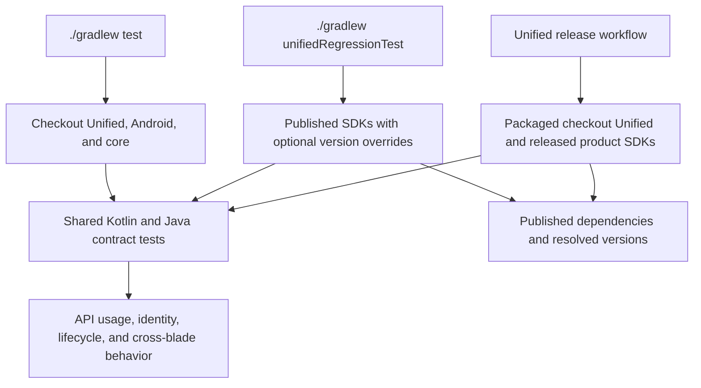

# SDK verification

The same JVM contract tests run against the checkout, published SDKs, or a packaged Unified release candidate. They cover Unified, Experiment, and Session Replay. Engagement is outside this suite.

## Everyday development

```bash
./gradlew test
```

The verification module uses project dependencies for Unified, Analytics Android, and core. Released Experiment and Replay plugins come through Unified's dependencies. No publication, version flags, exclusions, or emulator are needed. To run just these contracts, use `./gradlew :sdk-verification:test`.

PR CI runs these tests with the rest of the repository's tests.

## Published regression testing

```bash
./gradlew unifiedRegressionTest
./gradlew unifiedRegressionTest -PunifiedVersion=1.1.0 -PanalyticsVersion=1.36.0
```

The root task runs an independent consumer build using the same test sources and dependencies. It resolves published SDKs from Maven Central and Google, without Maven Local or project substitution. It never publishes the checkout.

| Property | Default |
|---|---|
| `unifiedVersion` | Version recorded in `unified/gradle.properties` |
| `analyticsVersion` | Unified's normal dependency resolution; override constrains Android and core together |
| `experimentVersion` | Unified's normal dependency resolution |
| `sessionReplayVersion` | Unified's normal dependency resolution; override constrains plugin and recording SDK together |

Only explicit overrides are constrained. The runner reports resolved SDK versions, verifies overrides, and checks Unified's declared product dependencies. Missing versions fail without falling back to checkout code. Older releases can fail compilation if they lack APIs exercised by the current contracts.

This is a local command for manual checks, including LLM-driven version combinations. There is no standalone GitHub dispatch workflow. Reports and resolved versions are saved under `sdk-verification/published/build/reports/`; they are separate from checkout test results.

Both nested runners use the root `local.properties` SDK location when no nested SDK configuration, SDK environment variables, or `android.home` system property are supplied.

## Unified release check

The Unified release workflow packages checkout Unified into `build/unified-release-maven`, then runs `./gradlew unifiedReleaseTest -PunifiedVersion=<candidate-version>`. It runs before publication for dry-run, normal release, and publish-only modes. A failure blocks publication.

Only candidate Unified comes from the isolated repository. Analytics, Experiment, and Replay use Unified's declared released dependencies from Google and Maven Central. Missing candidates fail without falling back to a released Unified artifact. This checks the packaged candidate before the release version bump; it does not publish to Maven Central or wait for Maven Central propagation.

To reproduce locally using JDK 21:

```bash
candidate="$(sed -n 's/^VERSION_NAME=//p' unified/gradle.properties)-release-check-$(git rev-parse --short HEAD)-SNAPSHOT"
./gradlew :unified:publishToMavenLocal -PVERSION_NAME="$candidate" -PsignAllPublications=false \
  -Dmaven.repo.local="$PWD/build/unified-release-maven"
./gradlew unifiedReleaseTest -PunifiedVersion="$candidate"
```

The release check reuses the published runner's reports directory. It does not accept product overrides. `unifiedRegressionTest` retains published-only resolution and all version overrides.

## Shared contracts

| Area | Scenarios |
|---|---|
| Consumer APIs | Kotlin/Java construction, builders, accessors, plugin interfaces, inherited Analytics calls |
| Identity | User/device IDs, properties, Identify operations, session changes, reset, identity-then-track ordering |
| Lifecycle | Registration timing, opt-out/in, duplicates, caller-owned clients, removal, replacement, setup failure |
| Cross-product behavior | Blade enablement, isolated instances, Experiment exposure enriched by Replay |

## How it works



Tests exercise real SDK implementations. MockWebServer supplies local responses; only the setup-failure boundary is mocked. Third-party-host scenarios use a minimal test host implementing the SDK interfaces.

## Known upstream limitation

Published Replay 0.31.0 enriches `BaseEvent` through its legacy `EventPlugin` adapter. A host supplying another `AnalyticsEvent` implementation receives no Replay ID. The custom-event regression retains the expected assertion but is skipped in the required gate until Replay supports it. Reproduce with `-PsdkVerificationCustomEvents=true` added to the verification command. The existing third-party-host gate uses the supported `BaseEvent` type.
